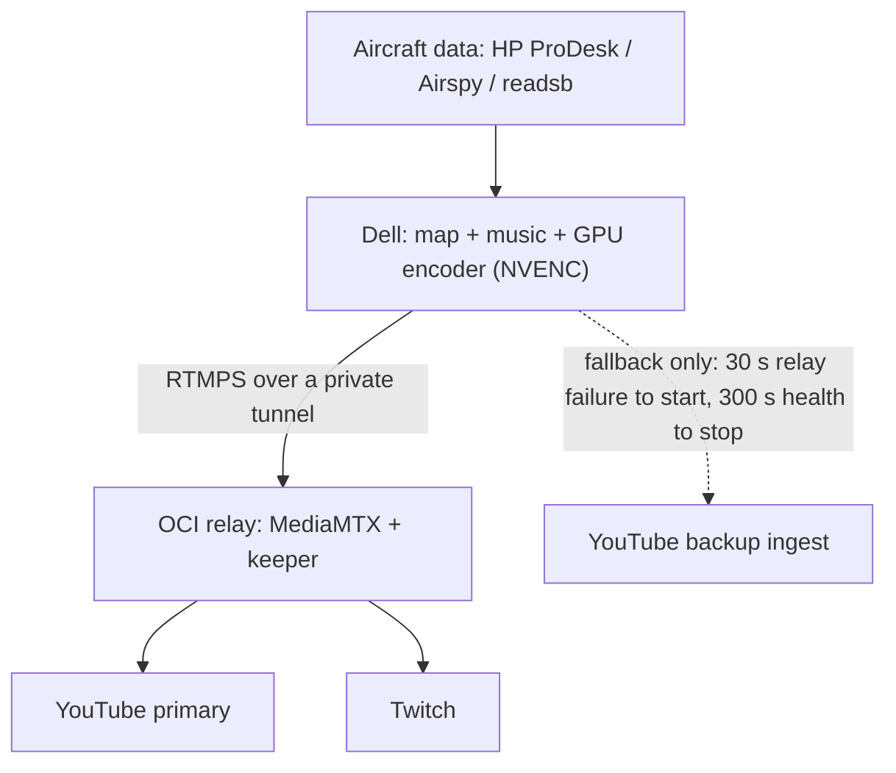
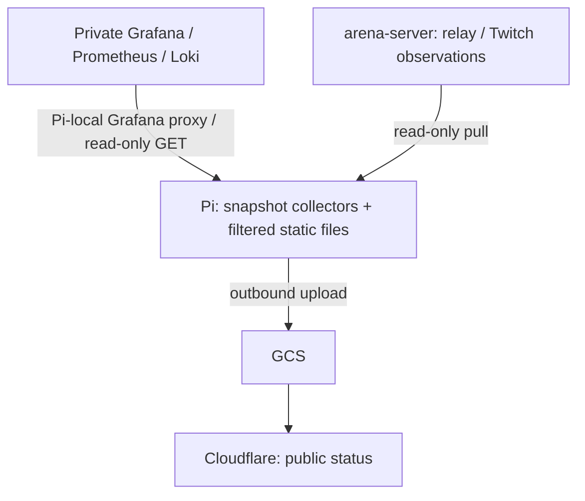

# stream_v3

**Watch:** [YouTube](https://www.youtube.com/@yukimurata0421/live) ·
[Twitch](https://www.twitch.tv/tokyoflighttracker) ·
[Public status](https://yukimurata0421.dev/)

## 30-Second Summary

I built and operate a continuous aircraft-map stream on a home network.
It combines live aircraft data, weather, and music, then uploads one video feed
to an Oracle Cloud Infrastructure (OCI) relay that forwards it to YouTube and
Twitch. If the relay path fails, the home host adds a direct YouTube backup
upload by itself and removes it once the relay has recovered.

The engineering challenge is keeping the stream recoverable when the network,
encoder, monitoring, or cloud relay fails. This repository shows the code,
measurements, and operational decisions behind that work. It is a small,
single-operator system; its value is the handling of real failures and uncertain
results, rather than service scale.

For hiring review, start with the results below and
[short incident stories](docs/operational-case-studies.md).
Implementation details are available after that first pass.

## Evidence Snapshot

**At least 160 days of same-URL observation**, from May 6 through October 14,
2026. The YouTube video ID stayed the same at the reviewed checkpoints.
The later daily record began on May 28 and contains **140 / 140 checkpoint
dates**, with **zero recorded URL transitions**.

This measures URL preservation, **not uninterrupted frame delivery**. Network
outages and restarts occurred. The latest checkpoint is
`2026-10-14 00:04:57 JST`; it is not a promise about every frame or later state.
See [the dated evidence and counting method](docs/28-day-same-url-sli-case-study.md).

| What the project demonstrates | Evidence |
| --- | --- |
| Preserve a usable public URL through changes and recovery | Same-URL checkpoints, retained migration evidence, and recovery guards. |
| Diagnose faults across several layers | Network stalls, a watchdog that rejected a new relay port, and stale public-cache incidents. |
| Correct recovery without hiding failed attempts | A Twitch renewal initially disrupted YouTube; the corrected bounded exercise was verified separately. |
| Recognize when testing has not proved safety | The qualification harness failed to produce its results; native qualification remains unverified. |
| Simplify when verification outgrows delivery | A signed-lease route with 104 qualification runs never reached unattended operation; a smaller self-healing route replaced it the same morning. |
| Exercise recovery on purpose | Stopping the relay during a live broadcast started the fallback in 52 seconds and returned to one upload without an operator; the broadcast did not end. |

The [incident stories](docs/operational-case-studies.md) explain what happened,
what changed, what was checked, and what remains unknown.

## System Architecture

### Video delivery

Dell mirrors aircraft data through readsb / modified tar1090, renders the map,
mixes music, and encodes once. The home uplink carries one feed; OCI does the
fan-out. A second upload exists only while the relay path is failing.

### Public status

Internal monitoring stays private. Raspberry Pi's snapshot collectors pull
filtered information, build static files, and upload them to the public edge.
Public readers do not connect to the private monitoring services.

### Recovery source contract

The public code separates monitoring, recovery decisions, and the component
that owns a process. Monitoring supplies facts; CRA (Central Restart Authority)
handles policy and authorization; Dell owns the exact media-process effect.
Raspberry Pi only publishes status. In the included policy,
`production_behavior_change_authorized=false`: this code does not enable a
live CRA command path.

The media route's fallback is deliberately outside CRA. It uses restart loops
and one controller with fixed thresholds, so it keeps working when monitoring
or authorization is unavailable. The [runtime contract](docs/v3/current-runtime-contract.md),
[self-healing fan-out](docs/v3/self-healing-oci-fanout.md), and
[decision record](docs/v3/oci-route-simplification-decision.md) contain the
detailed rules and trade-offs.

## Key Design Decisions

<!-- Public claim mapping: `SV3-SAME-URL`, `SV3-RECOVERY-GUARD`, `SV3-PUBLIC-BOUNDARY`, `SV3-EVIDENCE-STRENGTH`. -->

- Recover an existing YouTube stream before considering a new URL.
- A warning is not permission to restart a larger component.
- Publish filtered static status without exposing the private backend.
- A process restart, moving bytes, and playable media are separate results.

These choices came from operational failures, not only architecture diagrams.
The [case studies](docs/operational-case-studies.md) connect each lesson to its evidence.

## Claims And Limits

The October 14 checkpoint extends the URL-identity record. It does not extend
older availability ratios or prove uninterrupted video/audio. Current warnings,
missing measurements, and actual delivery faults are treated separately.

The OCI/Twitch path has observed live reception and a corrected manual renewal.
Automatic fallback was exercised once, by stopping the relay service; tunnel
loss, a relay-host outage, provider-side failures, and the first keeper-driven
Twitch renewal were not exercised. Native failure qualification and long-term
reception soak are not established. Production credentials, raw logs, and databases
are excluded from this repository. The [scorecard](docs/operational-scorecard.md)
keeps measured results, source tests, and remaining gaps separate.

## Review Paths

1. [Hiring reviewer guide](docs/hiring-reviewer-guide.md): a two-minute overview or a short technical interview path.
2. [Operational scorecard](docs/operational-scorecard.md): results, dates, and evidence limits.
3. [Implementation review map](docs/implementation-review-map.md): selected code and tests for a deeper review.
