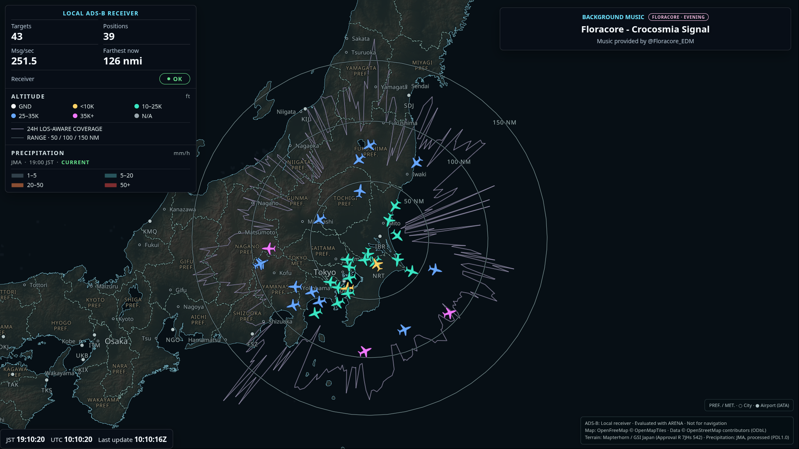
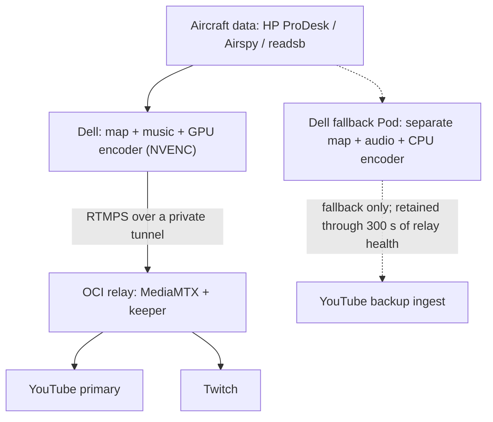
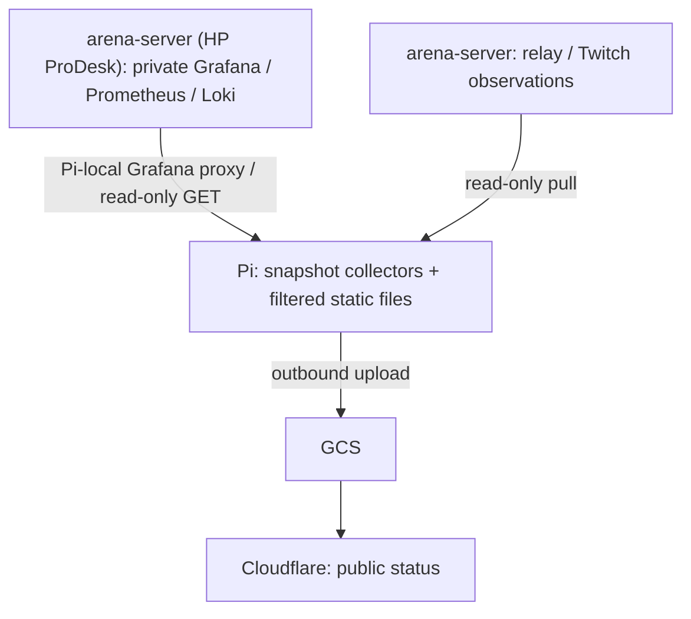

# stream_v3

**Watch:** [YouTube](https://www.youtube.com/@yukimurata0421/live) ·
[Twitch](https://www.twitch.tv/tokyoflighttracker) ·
[Public status](https://yukimurata0421.dev/)

## 30-Second Summary

I built and operate a continuous aircraft-map stream on a home network.
It combines live aircraft data, weather, and music. Adding Twitch had to
preserve the existing YouTube Live broadcast without requiring two permanent
uploads from home. One feed therefore goes to an Oracle Cloud Infrastructure
(OCI) relay, which forwards it to both platforms. If relay health is lost or
cannot be observed, the home host starts a direct YouTube backup upload and
keeps it until five minutes of continuous relay health have been observed.

The engineering challenge is keeping the stream recoverable when the network,
encoder, monitoring, or cloud relay fails. This repository shows the code,
measurements, and operational decisions behind that work. It is a small,
single-operator system; its value is the handling of real failures and uncertain
results, rather than service scale.

For hiring review, start with the results below and
[short incident stories](docs/operational-case-studies.md).
Implementation details are available after that first pass.

## Evidence Snapshot

**At least 160 days of same-URL observation**, from May 6 through October 14,
2026. The YouTube video ID stayed the same at the reviewed checkpoints.
The later daily record began on May 28 and contains **140 / 140 checkpoint
dates**, with **zero recorded URL transitions**.

This measures URL preservation, **not uninterrupted frame delivery**. Network
outages and restarts occurred. The latest checkpoint is
`2026-10-14 00:04:57 JST`; it is not a promise about every frame or later state.
See [the dated evidence and counting method](docs/same-url-continuity-evidence.md).

| What the project demonstrates | Evidence |
| --- | --- |
| Preserve a usable public URL through changes and recovery | Same-URL checkpoints, retained migration evidence, and recovery guards. |
| Diagnose faults across several layers | Network stalls, a watchdog that rejected a new relay port, and stale public-cache incidents. |
| Correct recovery without hiding failed attempts | A Twitch renewal initially disrupted YouTube; the corrected bounded exercise was verified separately. |
| Recognize when testing has not proved safety | The qualification harness failed to produce its results; native qualification remains unverified. |
| Recognize an unfinished design and change course | After 104 qualification runs, the redesigned migration and recovery system was still incomplete. A smaller route replaced it on October 20. |
| Exercise recovery on purpose | A relay-stop drill started the fallback in 52 seconds. After the operator restarted the relay, the senders reconnected and the fallback stopped automatically; the broadcast did not end. |

The [incident stories](docs/operational-case-studies.md) explain what happened,
what changed, what was checked, and what remains unknown.

## System Architecture

### Video delivery

Dell mirrors aircraft data through readsb / modified tar1090, renders the map,
mixes music, and normally encodes one feed. OCI does the fan-out. During
fallback and the five-minute recovery confirmation window, a separate CPU
encoder and direct YouTube upload may run alongside the main GPU path.

The [OCI delivery record](docs/v3/self-healing-oci-fanout.md) explains the
Tokyo OKE capacity attempt, the choice of a VM, and the fallback conditions.
Both home senders still depend on the Dell host and home uplink. A separate
[clock monitor](docs/v3/relay-clock-monitor.md) checks returned relay/fallback
video and keeps that evidence distinct from public-player reception.
An independent [Twitch thumbnail monitor](docs/v3/twitch-thumbnail-monitor.md)
adds provider-image clock checks on the monitoring host, using RAM for normal images.

### Public status

Internal monitoring stays private. Raspberry Pi's snapshot collectors pull
filtered information, build static files, and upload them to the public edge.
Public readers do not connect to the private monitoring services.

### Recovery

Production recovery is local and bounded. Fast recovery inside the Dell Pod
replaces a failed FFmpeg child; the OCI relay restarts itself; a keeper
re-creates failed forwards; and one controller adds the direct YouTube fallback
while relay health is lost. These pieces use fixed thresholds and keep working
when monitoring is down. The monitor on arena-server can only request a guarded
runtime restart, and replacement-broadcast creation is disabled.
[Architecture](docs/architecture.md#who-can-act-on-what) lists each actor's limits.

The repository also contains CRA (Central Restart Authority), a separate
recovery design study that separates facts, authorization, and one fenced effect. Its policy
sets `production_behavior_change_authorized=false`; it is not enabled, and the
media route does not use it. The
[decision record](docs/v3/oci-route-simplification-decision.md) explains why the
route was simplified instead.

## Key Design Decisions

<!-- Public claim mapping: `SV3-SAME-URL`, `SV3-RECOVERY-GUARD`, `SV3-PUBLIC-BOUNDARY`, `SV3-EVIDENCE-STRENGTH`. -->

- Recover an existing YouTube stream before considering a new URL.
- A warning is not permission to restart a larger component.
- Publish filtered static status without exposing the private backend.
- A process restart, moving bytes, and playable media are separate results.
- When repeated fixes do not finish a design, replace it with a smaller one that
  recovers on its own.

These choices came from operational failures, not only architecture diagrams.
The [case studies](docs/operational-case-studies.md) connect each lesson to its evidence.

## Claims And Limits

The October 14 checkpoint extends the URL-identity record. It does not extend
older availability ratios or prove uninterrupted video/audio. Current warnings,
missing measurements, and actual delivery faults are treated separately.

Automatic fallback was exercised once, by stopping the relay service. Other
relay failure modes, the keeper's scheduled Twitch renewal, and long-term soak
are listed as unobserved in [current status](docs/current-status.md).
Production credentials, raw logs, and databases are excluded from this
repository. The [scorecard](docs/operational-scorecard.md) keeps measured
results, source tests, and remaining gaps separate.

## Review Paths

1. [Hiring reviewer guide](docs/hiring-reviewer-guide.md): a two-minute overview or a short technical interview path.
2. [Operational scorecard](docs/operational-scorecard.md): results, dates, and evidence limits.
3. [Implementation review map](docs/implementation-review-map.md): selected code and tests for a deeper review.
4. [Current status](docs/current-status.md): recent changes and what has not been observed yet.
