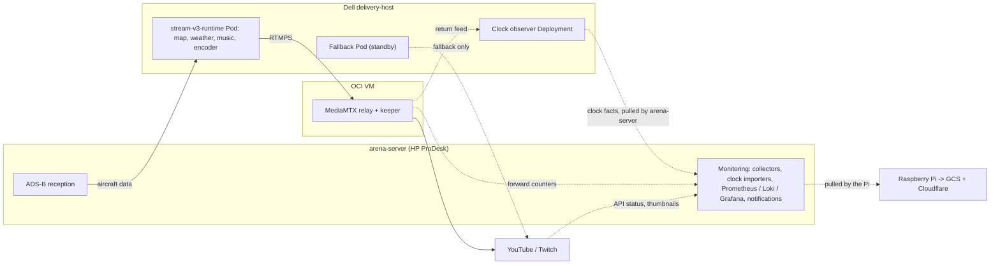
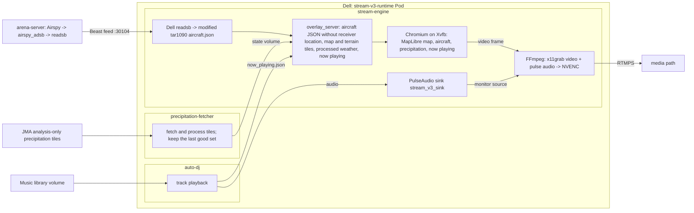
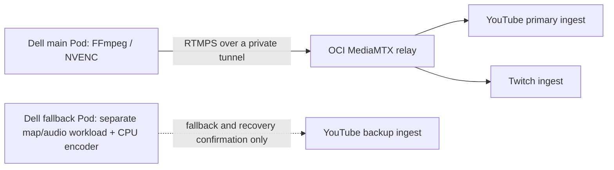
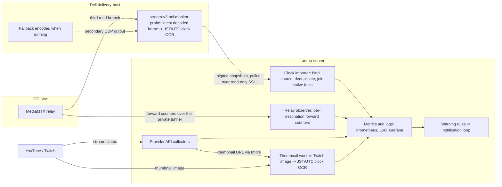

# Architecture

This page is the single description of the current hosts, data paths, and
ownership boundaries. The [runtime contract](runtime-contract.md) holds the
delivery settings, [evolution](evolution.md) holds the earlier topologies, and
[current status](current-status.md) holds recent changes and unobserved items.

The design keeps media delivery, observation, and public publication on
separate owners, so a warning in one cannot silently become an action in
another.

The main sender uses FFmpeg's internal FIFO to reconnect output while retaining
the encoder. Its [connection observer](v3/ffmpeg-fifo-recovery.md) tracks socket
generations independently of process generations. FFmpeg exit still belongs to
the existing child lifecycle; the relay-health controller independently owns
backup delivery. The [dated experiment and rollout](v3/ffmpeg-fifo-measurements.md)
separate those paths and retain the failed first audio rollout.

## Hosts And Roles

| Host or edge | Role | Runs |
| --- | --- | --- |
| HP ProDesk `arena-server` | ADS-B reception and monitoring | Airspy USB receiver, `airspy_adsb`, readsb; the monitor service `stream-v3-arena-monitor` (YouTube resolver and watchdog, stream watchdog, notifications, SLI, exporter); Prometheus, Loki, and Grafana in a local k3s; relay observation over the private tunnel |
| Dell workstation `delivery-host` | Video production and upload | Dell-side readsb and modified tar1090 endpoint; k3s `stream-v3-runtime` (map rendering, precipitation, PulseAudio, AutoDJ, FFmpeg/NVENC, fast recovery); the fallback Deployment and its controller; an independent RAM return-feed observer |
| OCI VM | Media fan-out | MediaMTX relay and the keeper that repairs forwards and renews Twitch |
| Raspberry Pi `publisher-host` | Public status publisher | nginx `/grafana/` proxy to arena-server Grafana, snapshot collectors, static site build, outbound GCS upload |
| GCS + Cloudflare | Public static edge | Serves <https://yukimurata0421.dev/> from uploaded static files |
| `cra-01` | CRA design target | Central Restart Authority source; production authority is disabled, and it takes no part in the media route |

Monitoring and ADS-B reception share the ProDesk; video production has the Dell
to itself. The [hardware selection](hardware-selection.md) explains why.

## Overview

Each diagram below answers one question. Boxes are hosts; solid arrows carry
media or source data; dashed arrows carry observation data or a standby path.
Arrows show data direction, and a label names the initiator when the receiver
pulls.



[Content production](#content-production) shows how the inputs become one
picture and one audio stream, [media path](#media-path) shows delivery,
[clock observation path](#clock-observation-path) shows what is watched, and
[public status path](#public-status-path) shows publication.

## Content Production

Three inputs are processed separately inside the Dell Pod and merge only in the
browser frame and the PulseAudio sink that FFmpeg captures.



Music therefore reaches the stream twice: as audio through PulseAudio and as the
on-screen track name. Precipitation is a degradable layer; the browser hides it
after the stale interval while delivery continues. The viewer-facing map is the
repository-owned MapLibre renderer, not the upstream tar1090 page.
`src/stream_core/overlay_server.py` serves the ADS-B JSON, map and terrain
tiles, precipitation assets, now-playing data and render readiness. The k3s
manifests do not manage the Airspy device or readsb.

The production overlay `deploy/k3s/streaming` runs four containers:
`stream-engine`, `precipitation-fetcher`, `auto-dj` and `fast-recovery-loop`.
The base `deploy/k3s/v3-runtime` manifest used for shadow validation has a
`network-observer` container instead; the overlay removes it and adds the
recovery loop.

## Media Path



The fallback bypasses OCI but shares the Dell host, home power, and home
uplink with the main sender. The [route record](v3/self-healing-oci-fanout.md)
defines when it starts and stops.

## Clock Observation Path



The OCI relay has a third read branch to a separate Dell monitor Deployment.
That branch observes the common relay output, alongside the independent native
YouTube/Twitch forward counters already collected by arena-server. During direct
fallback, a secondary tee/FIFO output of the backup encoder reaches the same
Dell monitor through a bounded UDP receiver. It adds no second encode.

The observer returns signed RAM snapshots, clock facts and heartbeat over the
existing read-only SSH path to ProDesk. ProDesk binds the source and current
runtime, deduplicates cycles, joins existing native relay facts and exports
observation metrics. Neither the image worker nor this importer can restart a
sender, scale a Deployment, switch a route or request a recovery action.
The [clock contract](v3/relay-clock-monitor.md) separates returned video,
per-destination byte progress, observation quality and public reception.

An independent [thumbnail worker](v3/twitch-thumbnail-monitor.md) runs entirely on
arena-server. An adapter reuses the existing Get Streams response and mirrors
its URL into tmpfs; the worker fetches a bounded image once per minute, keeps
ordinary images in RAM and joins paired-clock results with the existing API and
native facts. Its scope is a provider thumbnail, not public-player reception.
It adds no work to the Dell media path or OCI relay and has no recovery authority.

What each of these layers can and cannot establish is defined once in
[observability](observability.md#video-observation-layers). Warning rules feed
the existing notification loop; none of these observation paths can act on
delivery.

## Public Status Path

```text
Pi collector -- HTTP GET --> Pi-local /grafana/ proxy --> arena-server Grafana
             <-- datasource JSON (Prometheus / Loki) --
Pi collector -- relay and Twitch observations, read-only pull --> arena-server
Pi -> filtered static files -> outbound upload -> GCS -> Cloudflare -> yukimurata0421.dev
```

The Pi initiates every request; arena-server never pushes to it. Public readers
reach only the static edge, so they do not load the home uplink and cannot
reach Grafana, Prometheus, Loki, raw logs, credentials, or the home network.
Non-static operational access is outside this path and is not named here. The
[publisher boundary](v3/public-publisher-boundary.md) lists what is allowed
into the snapshot.

## Who Can Act On What

| Actor | Can change | Cannot change |
| --- | --- | --- |
| Fast recovery inside the Dell Pod | The FFmpeg child of its own Pod | Pods, Deployments, or the relay |
| Kubernetes on Dell | Restarts a failed container or Pod | Anything on OCI |
| Fallback controller on Dell | Scales only `stream-v3-youtube-backup` between 0 and 1 | The main Pod or the relay |
| Keeper on OCI | Re-creates a failed forward; renews the Twitch forward | The YouTube forward during renewal; anything at home |
| Clock observer on Dell / its importer on arena-server | Their bounded RAM snapshots, independent observation state and metrics | Senders, routes, replicas, provider lifecycle or recovery effects |
| Monitor on arena-server | Requests a guarded runtime restart (budget, cooldown, 180-second convergence wait) | The FFmpeg process directly; replacement broadcasts (disabled) |
| Raspberry Pi | Its own static output | Anything else; it receives no control feedback |
| CRA on `cra-01` | Nothing in production | Its policy keeps `production_behavior_change_authorized=false` |

The route's self-healing pieces (keeper and fallback controller) use fixed
thresholds and do not depend on the monitor, so they keep working when
monitoring is down. The guarded restart gates are described in the
[runtime contract](runtime-contract.md#guarded-restart-gates).

### CRA design

CRA is a stricter recovery design kept in the source: monitoring publishes
facts only, `cra-01` owns policy, budget, cooldown, authorization, and command
lifecycle, and Dell executes at most one exact fenced FFmpeg-child effect.
`OUTCOME_UNKNOWN` blocks automatic retry until reconciliation. It is not enabled
in production, and the current route does not use it; the
[decision record](v3/oci-route-simplification-decision.md) explains why. Read
[scoped recovery authority](v3/scoped-recovery-authority.md) and the
[recovery-control README](../recovery-control/README.md) for the design. A
smaller [local reflex path](../recovery-control/docs/local-reflex-authority.md)
keeps the restart decision on Dell under a policy signed by `cra-01`; it runs
only in `dry_run` and sends no restart requests.

## Failure Domains

| Domain | Examples | Usual owner |
| --- | --- | --- |
| RF and source | Airspy, `airspy_adsb`, readsb freshness on either host | arena-server, Dell readsb |
| Map and source data | tar1090 endpoint, tiles, precipitation, browser render heartbeat | Dell runtime |
| Media runtime | Browser, PulseAudio, AutoDJ, FFmpeg, NVENC | Dell runtime |
| Cloud media route | Private tunnel, relay host, a provider forward | Relay, keeper, fallback controller |
| Home network | WAN or carrier interruption | Not recoverable by any host; diagnosed by [route observation](v3/tcp-stall-case-study.md) |
| Observation | Stale evidence, exporter timeouts, monitoring drift | arena-server |
| Publication | Stale snapshot, cache policy | Raspberry Pi |

A failure in one domain does not establish a failure in another. That is why a
source or monitoring warning is not treated as a stream-restart condition.

## Deployment Layout

| Path | Purpose |
| --- | --- |
| `deploy/k3s/streaming` | Live delivery overlay for the Dell runtime |
| `deploy/k3s/shadow` | Shadow validation with local capture and dry-run recovery |
| `deploy/k3s/youtube-backup` | Fallback Deployment, normally zero replicas |
| `deploy/k3s/v3-control`, `deploy/k3s/v3-observer` | k3s packaging of the monitor loop and exporter; production runs the same loop as the arena-server service |
| `deploy/k3s/v3-reports` | Scheduled report jobs |
| `deploy/k3s/v2-state-mirror` | Optional read-only state mirror used during migration |
| `ops/selfheal/` | Keeper, fallback controller, and example units |
| `ops/monitoring/` | Prometheus, Loki, Grafana, and Alloy configuration |
| `ops/public-publisher/` | Pi collectors, site, and uploader |
