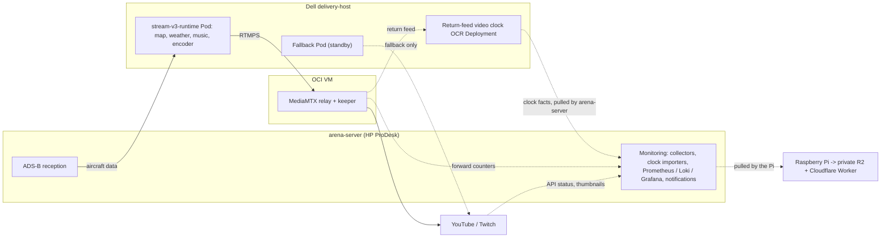
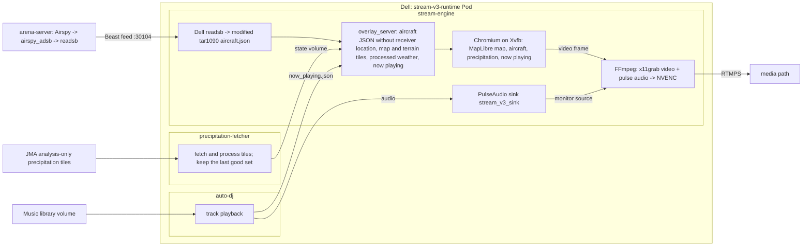
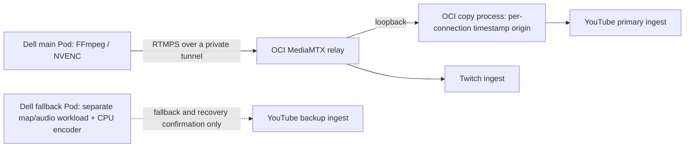
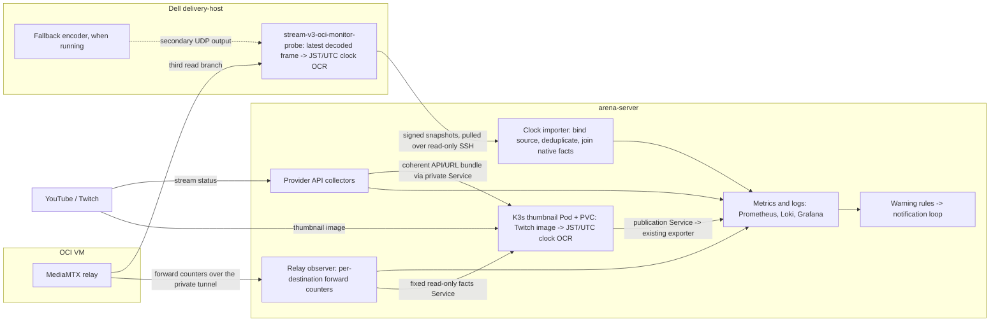
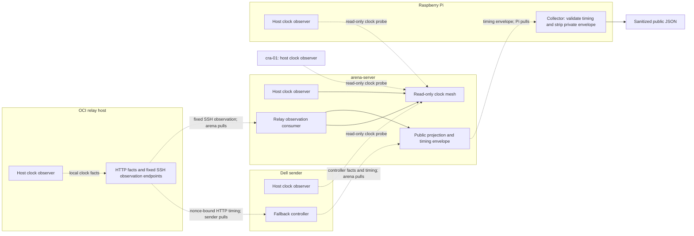

# Architecture

This page is the single description of the current hosts, data paths, and
ownership boundaries. The [runtime contract](runtime-contract.md) holds the
delivery settings, [evolution](evolution.md) holds the earlier topologies, and
[current status](current-status.md) holds recent changes and unobserved items.

The design keeps media delivery, observation, and public publication on
separate owners, so a warning in one cannot silently become an action in
another.

The main sender uses FFmpeg's internal FIFO to reconnect output while retaining
the encoder. Its [connection observer](v3/ffmpeg-fifo-recovery.md) tracks socket
generations independently of process generations. FFmpeg exit still belongs to
the existing child lifecycle; the relay-health controller independently owns
backup delivery. The [dated experiment and rollout](v3/ffmpeg-fifo-measurements.md)
separate those paths and retain the failed first audio rollout.

When the backup starts and stops is defined in the
[fallback decision contract](v3/fallback-decision-contract.md). Media freshness
and UTC diagnostics have independent roles. Evidence remains limited to the
hop observed: Dell ACKs do not establish the relay's YouTube output. Arena
keeps its secondary-recovery veto and existing notification owner; the
read-only projection gains no delivery provider or recovery authority.

## Hosts And Roles

| Host or edge | Role | Runs |
| --- | --- | --- |
| HP ProDesk `arena-server` | ADS-B reception and monitoring | Airspy USB receiver, `airspy_adsb`, readsb; the monitor service `stream-v3-arena-monitor` (YouTube resolver and watchdog, stream watchdog, notifications, SLI, exporter); Prometheus, Loki, and Grafana in a local k3s; relay observation over the private tunnel; local host clock observer and read-only clock mesh |
| Dell workstation `delivery-host` | Video production and upload | Dell-side readsb and modified tar1090 endpoint; k3s `stream-v3-runtime` (map rendering, precipitation, PulseAudio, AutoDJ, FFmpeg/NVENC, fast recovery); the fallback Deployment and its controller; an independent RAM return-feed video observer; a separate host clock observer and explicit manual-maintenance command |
| OCI VM | Media fan-out | MediaMTX relay, timestamp-rebasing YouTube copy and keeper; read-only facts endpoints and host clock observer |
| Raspberry Pi `publisher-host` | Public status publisher | nginx `/grafana/` proxy to arena-server Grafana, snapshot collectors, host clock observer and static site build; the operated uploader targets private R2 |
| Private R2 + Cloudflare Worker | Operated public static edge | Serves <https://yukimurata0421.dev/> from sanitized uploaded files; the public checkout retains the older GCS uploader example |
| `cra-01` | CRA central host | Policy/audit service and independent host clock observer; the public CRA remains `dry_run` and takes no part in the media route |

Monitoring and ADS-B reception share the ProDesk; video production has the Dell
to itself. The [hardware selection](hardware-selection.md) explains why.

## Overview

Each diagram below answers one question. Boxes are hosts; solid arrows carry
media or source data; dashed arrows carry observation data or a standby path.
Arrows show data direction, and a label names the initiator when the receiver
pulls.



[Content production](#content-production) shows how the inputs become one
picture and one audio stream, [media path](#media-path) shows delivery,
[clock observation path](#clock-observation-path) shows what is watched, and
[public status path](#public-status-path) shows publication.

## Content Production

Three inputs are processed separately inside the Dell Pod and merge only in the
browser frame and the PulseAudio sink that FFmpeg captures.



Music therefore reaches the stream twice: as audio through PulseAudio and as the
on-screen track name. Precipitation is a degradable layer; the browser hides it
after the stale interval while delivery continues. The viewer-facing map is the
repository-owned MapLibre renderer, not the upstream tar1090 page.
`src/stream_core/overlay_server.py` serves the ADS-B JSON, map and terrain
tiles, precipitation assets, now-playing data and render readiness. The k3s
manifests do not manage the Airspy device or readsb.

The optional [receiver-host reception guard](../ops/airspy-reception/README.md)
runs separately from these manifests. It verifies startup reception and can
make one additional Airspy-only restart per origin startup or gain transition.
The public unit is observation-only until explicitly enabled; gain schedules
and Bias-T power remain with the existing receiver operator/controller.

The production overlay `deploy/k3s/streaming` runs four containers:
`stream-engine`, `precipitation-fetcher`, `auto-dj` and `fast-recovery-loop`.
The base `deploy/k3s/v3-runtime` manifest used for shadow validation has a
`network-observer` container instead; the overlay removes it and adds the
recovery loop.

## Media Path



The fallback bypasses OCI but shares the Dell host, home power, and home
uplink with the main sender. The [route record](v3/self-healing-oci-fanout.md)
defines when it starts and stops.

## Clock Observation Path



The OCI relay has a third read branch to a separate Dell monitor Deployment.
That branch observes the common relay output, alongside the independent native
YouTube/Twitch forward counters already collected by arena-server. During direct
fallback, a secondary tee/FIFO output of the backup encoder reaches the same
Dell monitor through a bounded UDP receiver. It adds no second encode.

The observer returns signed RAM snapshots, clock facts and heartbeat over the
existing read-only SSH path to ProDesk. ProDesk binds the source and current
runtime, deduplicates cycles, joins existing native relay facts and exports
observation metrics. Neither the image worker nor this importer can restart a
sender, scale a Deployment, switch a route or request a recovery action.
The [clock contract](v3/relay-clock-monitor.md) separates returned video,
per-destination byte progress, observation quality and public reception.

The independent [thumbnail collector](v3/twitch-thumbnail-monitor.md) runs in
arena-server's K3s. A host adapter reuses the existing Get Streams response and
serves its API/URL pair over a private Service. Native facts cross a fixed GET-only
boundary; the Pod never reads host files or localhost. Its PVC retains numeric
state, history and bounded abnormal ROIs. The existing exporter reads the Pod's
publication Service without changing metric/job labels. Helix, relay observation
and the exporter remain host services. This does not move Dell's CRA processing
or media path, add a second sender, or give the collector recovery authority.
Its scope remains a provider thumbnail, not public-player reception.

What each of these layers can and cannot establish is defined once in
[observability](observability.md#video-observation-layers). Warning rules feed
the existing notification loop; none of these observation paths can act on
delivery.

## Host Clock and Freshness Path

Video-clock OCR above and host-clock timing below are separate observations.
The five host-clock observers read kernel/NTP facts and cannot set clocks.
The interval-based [clock contract](v3/cross-host-observation-time.md) dates from
October 31; it supersedes the controller's provisional October 30 tolerance.



The sender's facts path is independent of arena. The mesh exports diagnostic
facts and metrics, with no recovery policy or control feedback. Expired cached
evidence becomes UNKNOWN and cannot add healthy time. The public projection
contains neither internal machine/boot bindings nor the transport envelope.
Clock estimates never extend CRA authorization or command expiry.

The [route causal guard](v3/route-causality.md) adds an arena-owned veto before
watchdog budget reservation, resolver resync and provider lifecycle mutation.
Dell publishes a persistent cause ID as facts; arena decides whether to block
secondary recovery. Unknown or expired cause context also blocks it. Raw API
warnings remain visible and are only candidates for correlation. This guard
cannot grant recovery authority or extend CRA authorization.

## Public Status Path

```text
Pi collector -- HTTP GET --> Pi-local /grafana/ proxy --> arena-server Grafana
             <-- datasource JSON (Prometheus / Loki) --
Pi collector -- relay and Twitch observations, read-only pull --> arena-server
Pi -> filtered static files -> private R2 -> Cloudflare Worker -> yukimurata0421.dev
```

For public collection the Pi initiates every request; arena-server never pushes
publication data to it. The separate read-only clock mesh can probe the Pi
clock; that is not a publication or control channel. Public readers
reach only the static edge, so they do not load the home uplink and cannot
reach Grafana, Prometheus, Loki, raw logs, credentials, or the home network.
Non-static operational access is outside this path and is not named here. The
[publisher boundary](v3/public-publisher-boundary.md) lists what is allowed
into the snapshot. The [R2 case study](v3/r2-publication-and-freshness-case-study.md)
distinguishes the operated edge from the older uploader code retained publicly.

## Who Can Act On What

| Actor | Can change | Cannot change |
| --- | --- | --- |
| Fast recovery inside the Dell Pod | The FFmpeg child of its own Pod | Pods, Deployments, or the relay |
| Receiver-host reception guard, when explicitly enabled | One additional Airspy restart per origin startup, after a durable reservation | Gain or power policy, readsb, media processes, containers or hosts |
| Kubernetes on Dell | Restarts a failed container or Pod | Anything on OCI |
| Fallback controller on Dell | Scales only `stream-v3-youtube-backup` between 0 and 1 | The main Pod or the relay |
| Explicit operator running manual maintenance | Main Deployment replicas; fixed sender recovery timer/service; durable fallback inhibition; relay `alwaysAvailable`, `alwaysAvailableFile`, `alwaysAvailableTracks` | Provider destinations, credentials, fences, authority ownership, unrelated workloads or relay maintenance |
| Arena route causal guard | Its bounded read-only cause context and a secondary-recovery veto | Starting media, granting authority, changing budgets, NTP, CRA or Pi control |
| Host clock observers on all five hosts | Their bounded local current facts | System clocks, media, replicas, incident policy or authorization |
| Read-only clock mesh on arena-server | Its diagnostic cache and metrics | Clock setting, recovery effects, policy, credentials or the Pi's published artifacts |
| Keeper on OCI | Re-creates a failed forward; renews the Twitch forward | The YouTube forward during renewal; anything at home |
| Return-feed video-clock observer on Dell / its importer on arena-server | Their bounded RAM snapshots, independent observation state and metrics | Senders, routes, replicas, provider lifecycle or recovery effects |
| Monitor on arena-server | Requests a guarded runtime restart (budget, cooldown, 180-second convergence wait) | The FFmpeg process directly; replacement broadcasts (disabled) |
| Raspberry Pi | Its own static output | Anything else; it receives no control feedback |
| CRA agent / central | Observe decisions, sign policy and verify audit | `dry_run` sends no restart requests |

Manual maintenance is an explicit, existing-authority operation with durable
inhibition, shared locking, target binding and no resend of unknown effects.
Its return requires fresh progress and operator confirmation; clock observers
do not acquire those privileges. See the [maintenance boundary](v3/manual-maintenance.md).

The route's self-healing pieces (keeper and fallback controller) use fixed
thresholds and do not depend on the monitor, so they keep working when
monitoring is down. The guarded restart gates are described in the
[runtime contract](runtime-contract.md#guarded-restart-gates).

### CRA design

The current [CRA](../recovery-control/README.md) is the local reflex path:
Dell evaluates the managed FFmpeg child under centrally signed policy, while
`cra-01` publishes policy and verifies the append-only audit. The agent persists
limits and reservations; the Stream [Effect Executor](../src/runtime_boundary/)
owns exact-target admission and the durable generation fence. Unknown execution
is queried without resending the effect. CRA runs in `dry_run` and sends no
restart requests; it does not carry the media route.

The previous per-action central authorization, local fallback, leases, epochs
and soak machinery are kept in [history](../recovery-control/docs/history.md).
The [current contract](../recovery-control/docs/local-reflex-authority.md) and
[operations](../recovery-control/docs/local-reflex-operations.md) define the
conditions still required before enabling effects.

## Failure Domains

| Domain | Examples | Usual owner |
| --- | --- | --- |
| RF and source | Airspy, `airspy_adsb`, readsb freshness on either host | arena-server, Dell readsb |
| Map and source data | tar1090 endpoint, tiles, precipitation, browser render heartbeat | Dell runtime |
| Media runtime | Browser, PulseAudio, AutoDJ, FFmpeg, NVENC | Dell runtime |
| Cloud media route | Private tunnel, relay host, a provider forward | Relay, keeper, fallback controller |
| Home network | WAN or carrier interruption | Not recoverable by any host; diagnosed by [route observation](v3/tcp-stall-case-study.md) |
| Observation | Stale evidence, exporter timeouts, monitoring drift | arena-server |
| Publication | Stale snapshot, cache policy | Raspberry Pi |

A failure in one domain does not establish a failure in another. That is why a
source or monitoring warning is not treated as a stream-restart condition.

## Deployment Layout

| Path | Purpose |
| --- | --- |
| `deploy/k3s/streaming` | Live delivery overlay for the Dell runtime |
| `deploy/k3s/shadow` | Shadow validation with local capture and dry-run recovery |
| `deploy/k3s/youtube-backup` | Fallback Deployment, normally zero replicas |
| `deploy/k3s/v3-control`, `deploy/k3s/v3-observer` | k3s packaging of the monitor loop and exporter; production runs the same loop as the arena-server service |
| `deploy/k3s/v3-reports` | Scheduled report jobs |
| `deploy/k3s/v2-state-mirror` | Optional read-only state mirror used during migration |
| `ops/selfheal/` | Keeper, fallback controller, and example units |
| `ops/monitoring/` | Prometheus, Loki, Grafana, and Alloy configuration |
| `ops/public-publisher/` | Pi collectors, site, and uploader |
