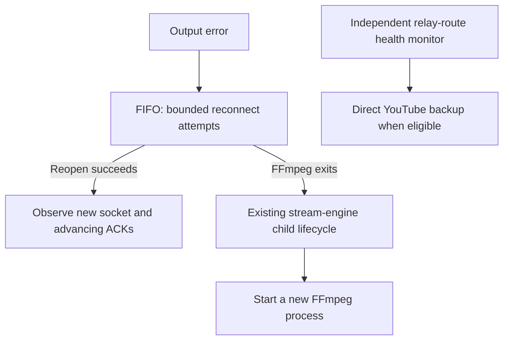

# FFmpeg Connection Recovery With FIFO

When the home uplink drops, the home-to-relay RTMPS connection can fail while
the encoder and capture inputs are healthy. The runtime reconnects only the
output, inside the same FFmpeg process, using FFmpeg's FIFO muxer. Process
replacement remains for FFmpeg exit. The runtime records **process generations
and connection generations separately** so a reconnect is visible without a
new PID.

This page is the runtime contract: why this layer was chosen, what the public
source configures and observes, and what it does not claim. The
[dated measurements](ffmpeg-fifo-measurements.md) hold the timing results,
the failed first rollout and the corrected production exercise.

## Choosing The Recovery Layer

A WAN session change interrupts the WireGuard path between the home sender and
the relay. Three layers could absorb it:

| Option | What it requires | Status |
| --- | --- | --- |
| Ride through: keep the existing TCP connection open across the gap | Sender and relay timeouts longer than the gap, plus a judge that the surviving connection is delivering correctly again | Not adopted at this stage |
| Reconnect the output inside the same FFmpeg process (FIFO) | One explicit inner timeout and a finite retry policy | Adopted |
| Replace the FFmpeg process | Encoder, X11 capture and Pulse input re-initialized for a network event | Kept only for FFmpeg exit |

**Why not ride through yet.** Keeping a connection open is cheap; showing that
it is delivering correctly afterwards is not. That judge needs freshness and
jitter evidence collected as structured data, and thresholds calibrated
against it. None of that exists yet, and an uncalibrated judge fails silently:
a stalled connection treated as healthy can persist with no recovery action.
Reconnection has one threshold, and a wrong value produces a visible extra
reconnect instead.

**Why not replace the process.** A network gap does not require a new encoder.
Replacement restarts capture and encoding before the output can reconnect.

**What FIFO adds besides reconnection.** Its bounded packet queue sits between
the encoder and the socket, so a blocked connection drops queued packets on
overflow instead of stalling encoding.

**When to revisit.** The [transport telemetry](#observing-recovery-without-a-new-pid)
records connection generations, ACK progress and stalls. Reconnect frequency,
real gap durations and post-restoration ACK latency gathered from it are the
inputs a ride-through judge would need.

## Recovery Boundaries



The stream engine already handled FFmpeg exit; this change keeps that path. It
adds no timer that kills a live FFmpeg process and no escalation to Pod,
container or host restart. Backup delivery follows its own route-health
conditions and does not wait for reconnect or restart attempts to finish.
Decisions in the [CRA design](../architecture.md#cra-design) remain separate.

## Output Configuration

The [argument builder](../../src/stream_core/engine/ffmpeg_args.py) and
[example profile](../../configs/fifo-recovery.env.example) use:

| Setting | Profile value | Reason |
| --- | --- | --- |
| Muxer | `-f fifo -fifo_format flv` | FFmpeg's packet queue and output thread; no OS `mkfifo` or application ring buffer. |
| Inner protocol timeout | `-format_opts rw_timeout=3000000` | Pass a 3 s timeout to the output opened inside FIFO. |
| Retry | 0.2 s wait, maximum 20 attempts | Finite attempts rather than unlimited retry. |
| Queue | 32 packets, drop on overflow | Bound queued output while encoding continues. |
| Restart | Wait for keyframe | Resume the new connection at a keyframe. |
| AV selection | Named video-filter output and `1:a:0` | Keep both streams when FIFO's automatic selection differs from FLV. |
| Video header | `-flags:v +global_header` | Include the H.264 decoder configuration in the FLV header. |
| Stderr | `info` with `-nostats` | Observe recovery reports without periodic progress lines. |

FIFO mode rejects an unlimited retry setting. Defaults keep FIFO disabled;
operators select a profile explicitly after checking their complete command.
The AV selection row exists because the first production rollout lost audio;
the [measurements](ffmpeg-fifo-measurements.md#the-first-rollout-lost-audio)
describe that failure.

## Observing Recovery Without A New PID

[TransportTelemetry](../../src/stream_core/engine/transport_telemetry.py)
consumes redacted stderr and TCP samples. The
[collector](../../src/stream_core/engine/fifo_runtime.py) is injected explicitly
into the existing runtime observation publisher; non-FIFO and test-mode paths
keep the original metrics supplier.

| Evidence | Interpretation |
| --- | --- |
| Same process generation, new socket cookie/inode | Increment the observed connection generation. A short-lived connection between polls is not counted. |
| ACK increase on that connection | Local transport progress. Socket counters restart with each connection. |
| Pending output, ACK unchanged for at least 4 s | `TCP_ACK_STALLED`: a read-only fact, not restart permission. |
| FIFO `Recovery successful` | FFmpeg reports a reopened output. |
| FIFO `Recovery failed` | One attempt failed; a later attempt can succeed. |
| Missing or ambiguous socket | Keep the existing empty `tcp_metrics` semantics. |

Counters reset per FFmpeg generation. Stderr can report a reopen before the
next socket poll, so that event carries the **last observed** connection
generation; the next socket observation establishes the new one. The snapshot
always reports `delivery_or_video_verified=false`.

The [target snapshot](../../recovery-control/src/dell_recovery_agent/target_snapshot.py)
accepts a single RTMPS FLV or FIFO output and keeps its existing ownership and
identity checks. Multiple outputs and unsupported inner formats are rejected.

### Output Files

| File | Location |
| --- | --- |
| `ffmpeg-transport.json`, `ffmpeg-transport.prom` | Observation directory |
| `ffmpeg-transport-events.jsonl` | `STREAM_FIFO_TELEMETRY_JOURNAL_DIR`, or the observation directory if unset; 2 MiB rotation with three backups |

Mount the journal directory on persistent storage when events must survive
process or Pod replacement.

## Scope

This contract does not:

- verify delivered video or audio; a reopen report and ACK progress are local
  transport facts;
- guarantee a total recovery deadline; the retry policy bounds attempts, not
  elapsed time;
- treat the keyframe flag as proof of a decoded IDR or playback;
- add an arena-server scrape job, CRA database fields, public UI panels or
  control authority.

The production exercise verified the FIFO branch once. It did not exercise
retry exhaustion followed by process replacement and successful reception.

## Checks

```bash
python3 -m pytest -q tests/test_fifo_transport_telemetry.py \
  tests/test_fifo_runtime_integration.py tests/test_fifo_target_snapshot.py \
  tests/test_runtime_bootstrap_contracts.py tests/test_ffmpeg_stderr_capture.py
```

Install the public `recovery-control` package as described in the
[documentation guide](../README.md) for the integrated collector tests.
When FFmpeg/ffprobe are installed, the AV regression test writes a short local
FLV through the full output command and verifies both H.264 and AAC headers.
It uses synthetic inputs and CPU encoding, not a production capture device or
NVENC. The [lab tools](../../ops/fifo-lab/README.md) cover isolated protocol
timing.
