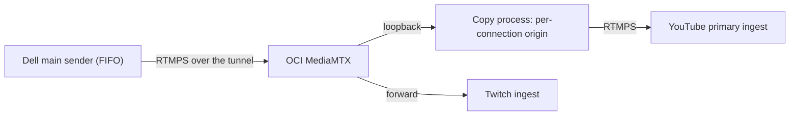

# Keeping The Encoder Also Kept Its Clock

Recorded: **2026-10-25 JST**. This is a dated case study, not a current health
report. It follows the [FIFO connection recovery](ffmpeg-fifo-recovery.md)
decision: reconnecting the output inside the same FFmpeg process keeps the
encoder running, and this incident showed what else that keeps. Private logs,
broadcast identifiers, stream keys, recordings and process identities are
excluded.

## Findings

- **Same-process recovery carried about 20 hours of media timestamps onto a new
  connection.** After a home uplink interruption, FIFO reconnected the Dell
  output and Twitch recovered, but the relay's new YouTube connection was closed
  about every six seconds for nearly three hours.
- **The relay health check did not see it.** The keeper accepted a
  `forwarding` state label as healthy, and that label appears before an RTMP
  connection is set up, so its 30-second repair condition was never reached.
- **A per-connection timestamp origin restored YouTube** without re-encoding:
  a copy process on the relay starts each YouTube connection at the first IDR
  and subtracts that point from video and audio timestamps.
- **The first fix changed two things at once**, the timestamp origin and the
  starting frame, so it did not prove the cause. A private YouTube comparison
  then changed only the origin: without it, 5, 5 and 6 unplanned reconnects;
  with it, none.
- **An end-to-end check on one private player** cut the connection during
  recording, recovered through FIFO in the same process, and found continuous
  video and a 440 Hz test tone across the 487-second recording.

## What Happened

| Time (JST) | Event |
| --- | --- |
| 06:31-06:32 | A home uplink interruption. FIFO reconnected the output in the same FFmpeg process (connection generation 2 to 3). Relay input and the Twitch forward recovered. |
| From 06:32:08 | The relay's YouTube forward logged `EOF` about every six seconds with no outbound bytes. The YouTube backup sender was kept running through the repair. |
| 08:53 | A manual re-creation removed the YouTube forward from the forward list and added it back. MediaMTX matches forward handlers by list position, so the Twitch forward reconnected twice. Twitch player continuity during that window was not checked. Simple re-creation did not stop the `EOF`. |
| 09:22 | The YouTube forward was routed through the new copy process. Sending resumed two seconds later and continued on one session; no new `EOF` was logged. |
| 09:56-10:02 | The fallback controller was reconnected to the new output facts and stopped the backup after 300 seconds of continuous health. |

The YouTube API and the public receiver reported healthy at 09:31, but the
backup was also running then, so those checks do not show which ingest YouTube
was serving. Viewer impact during the outage was not measured.

## Why It Was Not Caught

**Timestamps survive both layers.** FIFO keeps the encoder, and the encoder's
clock keeps counting: after about 20 hours of operation, the new connection
starts at about 20 hours of media time. MediaMTX v1.21.2 passes stream
timestamps unchanged to its RTMP forward writer. Neither layer gives a new
downstream connection a fresh origin. Twitch accepted the continuing clock;
YouTube's new connection did not stay up.

**A state label stood in for progress.** The keeper re-creates a forward that
has not been forwarding for 30 seconds. MediaMTX reports `forwarding` before the
RTMP connection is established, so short-lived connections that sent nothing
still produced brief success labels, and each one reset the 30-second timer.
The fallback controller had a separate check of byte progress and kept the
backup running, but the relay itself never attempted repair.

## The Fix

| Component | Change |
| --- | --- |
| [Copy process](../../ops/selfheal/youtube-forward/) | Receives H.264/AAC on loopback and copies it to YouTube over RTMPS without re-encoding. For each connection, waits for the first IDR, uses its DTS as the common origin, and subtracts it from video PTS/DTS and audio PTS; drops media before that IDR; keeps the video composition offset; rejects timestamps that go backwards. If the YouTube side fails, it closes its input and the existing forward reconnects. |
| [Keeper](../../ops/selfheal/forward_keeper.py) | A forward counts as healthy only if the same handler stays `forwarding` without an error **and** its outbound bytes increase between samples. Repair replaces only the failing list slot with a placeholder and restores it, so other providers keep their handlers. |
| [Fallback controller](../../ops/selfheal/fallback_controller.py) | Reads YouTube health from the copy process's facts, served read-only over the tunnel by a [facts endpoint](../../ops/selfheal/route_facts_http.py): the expected process, boot and destination, fresh state, and increases in input bytes, YouTube output bytes, and both video and audio packets on the same connection. |
| [Relay observer](../../monitoring-v4/src/stream_monitoring_v4/compatibility/relay_observe.py) | Accepts YouTube counters only from the current copy process bound to the expected destination and fresh within 20 seconds; bytes handed to loopback are never reported as YouTube output. |

Twitch still receives the original timestamps directly from MediaMTX. The copy
process adds one bounded service on the relay and no new listening port beyond
loopback.

## Isolating The Cause

Each test used the same synthetic H.264/AAC fixture (1920×1080, 5 fps, GOP 10,
4 Mbps video, 48 kHz stereo 192 kbps audio) with 73,902.6 seconds, about
20 hours, added to every timestamp. The fixture was encoded once with
`libx264` and copied without re-encoding. In every trial the isolated relay's
input connection was cut once, and the same FFmpeg process reconnected through
FIFO.

| Test | What changed | Result |
| --- | --- | --- |
| Local receiver | Normal time, 20 h without origin, 20 h with origin, 20 h through the old direct forward | 3/3 reconnects with both tracks received and decoded in every condition. The local receiver did not reproduce the failure. |
| Private YouTube broadcast | 20 h timestamps with and without the origin; same copy code and same first-IDR start | Without the origin: 5, 5 and 6 unplanned reconnects. With it: 0, 0 and 0. YouTube reported `videoIngestionFasterThanRealtime` in one trial without the origin. |
| Same private player, end to end | Origin on; connection cut while the owner recorded the player | Sender resumed both tracks about 4.3 seconds after the cut, then 120 seconds with no unplanned reconnect. The 487-second recording decoded without error, with no black frame over 0.5 s, no freeze over 1 s, no window below -60 dBFS, and the 440 Hz tone present in every 0.1-second window. |

The local result kept the first fix from being read as proof. The provider
comparison held everything constant except the origin, which is why it supports
the cause. The media clock advanced at about 1.000× in both variants, so
"faster than realtime" describes YouTube's classification of the timestamps,
not the actual sending rate.

## What This Does Not Show

- YouTube's internal reason for closing the connection. The provider issue was
  captured in one trial only.
- A 20-hour outage or 20 hours of continuous operation; "20 hours" is the media
  timestamp offset carried into the new connection.
- NVENC output or production capture; the fixture was synthetic.
- Player recovery time. The player showed no observable stop, so the 4.3-second
  figure is sender-side only.
- More than one end-to-end run, long-term stability, AV sync, or gaps shorter
  than 0.1 seconds.

## Related

- [FIFO connection recovery](ffmpeg-fifo-recovery.md) and its
  [measurements](ffmpeg-fifo-measurements.md)
- [Self-healing OCI fan-out](self-healing-oci-fanout.md), the route this changed
- Tests: [self-healing route](../../tests/test_selfheal.py),
  [fallback on the copy route](../../tests/test_fallback_copy_route.py) and
  [relay observer](../../monitoring-v4/tests/test_relay_observe.py); the copy
  process has its own Go tests beside its source.
- Port records: [source code](../../publication/youtube-timestamp-origin-code-port-20261025.json) and
  [documentation](../../publication/youtube-timestamp-origin-docs-20261025.json).
