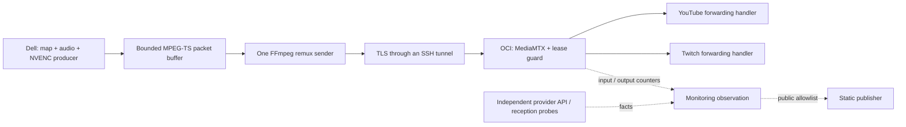

# OCI Relay And Two Provider Outputs

> Superseded on 2026-10-20: production now uses the
> [self-healing fan-out](self-healing-oci-fanout.md), and the signed-lease route
> below was stopped. See [why the unfinished recovery design was replaced](oci-route-simplification-decision.md).
> This page remains the record of the 2026-10-13 design and its evidence.

## Observed Route And Source: 2026-10-13

The delivery path observed on 2026-10-13 JST uses one Dell encoder and one
network sender. OCI receives that input and forwards it independently to
YouTube and Twitch. This supersedes the historical direct-to-YouTube diagram
for the primary media route. The ADS-B source, renderer, audio, and public
static publisher retain their separate responsibilities.

The public source is an adapted port, not an exact deployment image. Its
[source-port record](public-source-port-2026-10-13.md) explains the verified
running-source manifest, development-source additions, and portability changes.

## Delivery ownership

`DeliveryPipeline` separates the encoding producer from the remux sender.
The producer outputs MPEG-TS; the sender copies its video and audio codecs into
RTMPS. The packet buffer defaults to 2 MiB and three seconds, bounds stale input
and blocked output, and resumes from a usable keyframe boundary after dropping
old packets. It is not a durable queue or a promise of gapless reception.

The existing stream-engine owns creation and cleanup. `launch_delivery_ffmpeg`
is its integration hook; the runtime-boundary entrypoint installs the delivery
pipeline. There is no independent sender restart loop in `DeliveryPipeline`.
The public engine keeps the earlier effect audit and portable runtime helpers.

`PRIMARY` selects the OCI route. `FALLBACK` is an explicit, fenced route
transition to direct delivery. The typed route request binds the target,
expected route generation, authority, and lease. The presence of that code
does not enable automatic failover or grant production action authority.
Private rollout scripts and provider destinations are excluded.

## Relay ownership

The relay guard admits finite, signed leases with a durable sequence high-water
mark and elapsed-clock checks. Forwarding requires fresh input. Lease expiry,
clock drift, stale input, and output faults have bounded stop paths; a halted
instance cannot be revived by replaying a lease. This is a separate failure
domain from the Dell child lifecycle.

YouTube and Twitch have separate forwarding handlers. The daily Twitch owner
changes only the Twitch forwarding entry, checks YouTube handler identity and
counter progress, and retains uncertain dispatches without replay. See
[Twitch session renewal](twitch-session-renewal.md).

## Evidence boundaries

| Observation | Supported conclusion | Remaining uncertainty |
| --- | --- | --- |
| Dell sender ACK progress | The sender's selected TCP peer accepted bytes. | With the primary tunnel, that peer is loopback; OCI or viewer reception is not proved. |
| OCI input counter progress | The relay received bytes for the bound input connection. | Provider forwarding and decodability are separate. |
| Provider output counter progress | The bound forwarding handler advanced bytes. | Public LIVE status, media reception, and uninterrupted frames are separate. |
| Twitch API LIVE | A fresh, identity-bound provider session exists. | It does not prove delivered audio/video. |
| Guest HLS and decoded audio | Media was received and decoded in the sampled window. | Long-term delivery and every frame remain unmeasured. |

Read-only observation on 2026-10-13 confirmed an active OCI supervisor, a fresh
enabled guard, input progress, and both forwarding handlers. The historical
Twitch renewal exercise also sampled public media. These observations do not
complete native failure qualification, a 48-hour reception soak, automatic
failover qualification, or a new same-URL availability measurement.

## Reviewable implementation

- [Pipeline](../../src/stream_core/engine/delivery_pipeline.py) and
  [runtime integration](../../src/stream_core/runtime_boundary_entrypoint.py).
- [Lease client](../../src/stream_core/engine/relay_lease_client.py),
  [relay guard](../../ops/relay/relay_guard.py), and
  [relay supervisor](../../ops/relay/relay_supervisor.py).
- [Route fence tests](../../recovery-control/tests/runtime_boundary/test_stream_route_fence.py)
  and [pipeline tests](../../tests/test_delivery_pipeline.py).

These modules include effectful adapters for review. There is no public
credential set, host installer, enabled route change, or one-command deployment.
