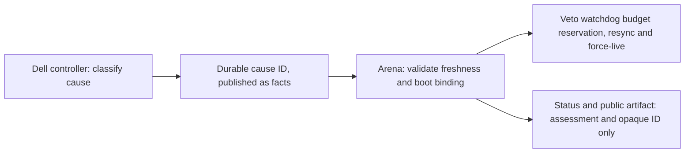

# Cause Identity And Secondary-Recovery Veto

On October 31, 2026, the fallback controller started classifying route problems
by cause: media failure, clock fault, observation loss or initialization. It
also started publishing one durable cause ID per incident, and arena began
using that ID to block secondary recovery. This page covers the cause ID and
the veto. When the backup starts and stops is defined only in the
[fallback decision contract](fallback-decision-contract.md).

The first version of this policy held the route on every observation loss. An
isolated relay stop showed that this hid real outages; the
[revision history](fallback-policy-revisions.md) records that step and the
corrections that followed.

## Why Secondary Recovery Needs A Veto

A relay outage produces symptoms on several hosts at once: the fallback
controller sees media failure, the YouTube watchdog sees a stalled broadcast,
and API warnings arrive. Without coordination, each automation would answer
the same cause with its own restart, resync or force-live call while the
backup is already carrying the stream. The cause ID lets those automations
recognize one incident and stand down.

## The Cause ID

The controller writes a bounded current cause ID to durable state before it
dispatches any action. The ID survives process and host restarts; action
budgets and health windows are not restored from it. The same ID covers the
failure, the backup period and the recovery. It closes only after the backup is
off and health has stayed stable for another 180 s, which covers one existing
API-observation freshness window. That settling time is a policy choice, not
proof that every provider warning clears within 180 s. State transitions go to
the existing logs.

## How Arena Uses It

Arena pulls the controller status through an existing nonce-bound read-only
helper. Source and responder boottimes are compared only within the same
machine and boot, and the whole client round trip is added conservatively.
Monotonic clocks from different hosts are never subtracted. The source must be
at most 45 s old, and its age is deducted from the receiver's remaining
validity. This path can still carry a veto during a wall-clock step, and it
never turns uncertain media evidence into healthy evidence.

Missing, expired, wrong-boot or malformed context also vetoes secondary
recovery. Rejected or unavailable UTC diagnostics retain that veto even when
the independent media assessment is HEALTHY. Arena checks its own NTP observation and holds recovery for 180 s
after an observed wall-clock step.

The pinned legacy monitor keeps its existing source and its disabled restart
flags. Admission hooks run before watchdog restart-budget reservation, typed
restart and resync decisions, and provider force-live calls. Raw warnings and
SLI history are kept, and status records attach the cause ID as a *candidate*
relationship: a YouTube API warning is not thereby proven to come from a
particular ingest. The public artifact exposes only the assessment, the opaque
cause ID, the context status and the veto state.

## Boundaries

The veto can only block. It cannot start media, grant recovery authority,
change budgets, or extend CRA authorization. The Raspberry Pi publisher stays
publish-only. CRA leases, fences and budgets are unchanged. Runtime FFmpeg
child recovery inside the main Pod is outside this veto.

The controller release needs its sibling modules `clock_contract.py`,
`route_assessment.py` and `maintenance_state.py`, a writable systemd
StateDirectory for the cause bookmark, and a RuntimeDirectory for atomic
status. Its credential keeps only the fallback Deployment permission. See the
[controller unit template](../../ops/selfheal/units/stream-v3-fallback-controller.service.in)
and the [arena observer template](../../monitoring-v4/ops/systemd/stream-v4-route-causality.service.in),
which requires fixed machine binding and read-only SSH configuration. These
templates describe the case study; they do not prove deployment elsewhere.

## Rollout Lesson

The first rollout placed the new monitor files, but an existing later systemd
drop-in still selected the old entry point. Verification therefore checks the
loaded ExecStart, the actual process command line and the watcher's output.
File placement is not deployment proof.

Sources: [controller](../../ops/selfheal/fallback_controller.py),
[classification and cause state](../../ops/selfheal/route_assessment.py),
[arena guard](../../monitoring-v4/src/stream_monitoring_v4/compatibility/route_causality.py),
[clock contract](cross-host-observation-time.md).
