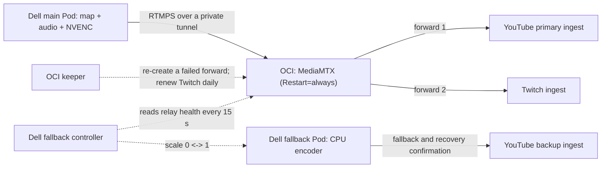

# Self-Healing OCI Fan-Out

## Goal And Choice Of OCI

The goal was to extend the stream to multiple platforms, starting with Twitch,
while keeping the existing YouTube Live broadcast as the first priority.
Sending a separate feed to each platform from Dell raised concerns about the
home uplink. Sending one feed to a cloud relay lets the relay handle distribution
without adding a permanent second upload at home.

Kubernetes was the initial choice for managing the relay as Pods. The operator
tried to obtain capacity for Oracle Kubernetes Engine (OKE) in the Tokyo region
for about two weeks, then chose an OCI VM when that capacity remained
unavailable. The transfer cost of continuous video was also a selection
constraint. The operator reports sufficient VM resources and outbound bandwidth
for the current two-platform workload; this record includes no independent
capacity benchmark or itemized comparison of cloud bills.

## Current Route: 2026-10-20

Since 2026-10-20 08:43 JST, the production media route uploads one feed from the
Dell encoder host to the OCI relay. The relay forwards that feed to YouTube and
Twitch. When relay health is lost or cannot be observed, the Dell host starts a
fallback sender that publishes directly to the YouTube backup ingest. It keeps
that sender running through the recovery confirmation window and stops it only
after five minutes of continuous relay health.

| State | Home uploads | What changes next |
| --- | --- | --- |
| Normal operation | One main feed to OCI. | A sustained unhealthy or unavailable relay observation starts the fallback. |
| Fallback | The main sender may continue or reconnect; a separate sender uploads directly to YouTube. | The fallback remains active while relay health is unhealthy or unknown. |
| Recovery confirmation | Both uploads can run while the relay forwards again. | After 300 seconds of continuous relay health, the fallback stops. |

The fallback Pod runs its own media workload with `libx264` CPU encoding. It
does not reuse the main Pod's NVENC output, and identical frame or audio timing
between the two feeds is not established. Sharing the main GPU is a possible
follow-up; it is not part of this implementation or the drill below.

This route replaces the signed-lease relay described in
[OCI relay and Twitch](oci-relay-and-twitch.md). Why the earlier design was
retired is recorded in
[Replacing an unfinished OCI recovery design](oci-route-simplification-decision.md).

## Components and how each one recovers

| Component | Where it runs | Recovery behavior |
| --- | --- | --- |
| Main sender | Dell k3s Deployment `stream-v3-runtime` | The engine reconnects five seconds after a dropped connection; Kubernetes restarts a failed Pod. |
| Relay | OCI systemd `stream-v3-oci-mediamtx` | `Restart=always` with a three-second delay. Tunnel access is restricted; the public unit is an example of the encoder allowlist. |
| Keeper | OCI systemd `stream-v3-oci-keeper` | Re-creates one forward that has not been forwarding, or has reported an error, for 30 seconds (at most once per minute per destination). Renews Twitch at 00:00 JST or after 46 hours. |
| Fallback controller | Dell systemd `stream-v3-fallback-controller` | Starts the fallback after 30 seconds of relay failure and stops it after 300 seconds of continuous relay health. |
| Fallback sender | Dell k3s Deployment `stream-v3-youtube-backup` | Normally zero replicas. While running, it reconnects on its own. |

Relay health means three things at once: the input path is ready, its received
byte counter advances, and the YouTube forward is `forwarding` without an error
while its outbound counter advances. An unreachable API or a missing sample
counts as unhealthy. The controller only stops the fallback after continuous
health; it never stops it because an observation is missing.

The YouTube forward is identified by the host of its own destination, not by
its position in the forward list. Until 2026-10-21 the controller, keeper, and
observer took position 1 as YouTube. While the keeper had removed a failing
YouTube forward, Twitch moved to position 1, and its advancing counters could be
read as YouTube health and delay the fallback. A missing or duplicated YouTube
forward now counts as unhealthy.

The monitoring host is not in this control loop. If monitoring is down, the
relay, keeper, and fallback controller still act on their own observations.

The 30-second start threshold is measured from the controller's unhealthy
observation. Polling occurs every 15 seconds, followed by Pod startup and
connection setup. It is not a promise of restored delivery within 30 seconds.

The fallback bypasses the OCI route; it still shares the Dell host, power, and
home uplink with the main sender. It cannot restore delivery through a failed
home WAN or a stopped Dell host. The controller checks the YouTube forward;
a Twitch-only fault is handled by the keeper and does not itself start the
YouTube fallback.

## Daily Twitch renewal

The keeper schedules Twitch renewal at 00:00 JST, or when the observed session
age reaches 46 hours. It removes the Twitch forward and waits at least 120
seconds from that removal. It then restores the forward when the Helix
observation is OFFLINE. This does not require 120 continuous seconds of OFFLINE
observations. At 600 seconds it restores Twitch even without OFFLINE confirmation.
During renewal it preserves the YouTube forward. The last renewal's JST date is
persisted across restarts.

The relay observer reports the renewal's scheduled time as today's 00:00 JST
while a renewal is in progress, and as the next 00:00 JST otherwise. The
monitoring host treats a Twitch OFFLINE as planned only within 360 seconds of
that time and only while a renewal is in progress, so the reported time must
not move to the next day mid-renewal.

Whether the first keeper-driven renewal has been observed is tracked in
[current status](../current-status.md).

## Drill: stopping the relay (2026-10-20 08:55 to 09:03 JST)

The relay service was stopped by hand and started again two minutes later.

| Elapsed from stop | Observation |
| --- | --- |
| 0 s | The relay stops; YouTube primary and Twitch forwarding stop. |
| 14 s | The fallback controller sees the relay path as unhealthy. |
| 52 s | The controller starts the fallback Pod. |
| 62 s onward | The fallback sends to the YouTube backup ingest. The YouTube API reported the broadcast live, active, and good 40 seconds later. |
| 118 s | The relay is started again. |
| 125 s | The main Pod reconnects to the relay on its own; both forwards resume. |
| 129 s | Twitch reports a new session as LIVE. |
| 456 s | After 300 seconds of continuous relay health, the controller stops the fallback. |

The YouTube broadcast did not end. The recorded gap in data reaching YouTube
was about 65 seconds; frame-level continuity was not measured. The operator
stopped and restarted the relay service. Starting and stopping the fallback,
reconnecting the main sender, and resuming both forwards then happened
automatically. This drill did not test an automatic restart of the relay itself.

The drill also exposed a monitoring gap. The YouTube watchdog on the monitoring
host counts only the main Pod's connection as local delivery. During the drill
it confirmed an incident even though the fallback was sending. Because that
watchdog was allowed to create a replacement broadcast, a longer relay outage
could have replaced the live broadcast. Replacement broadcast creation has been
disabled at 09:10 JST; if a broadcast really ends, it is recreated by hand.
At 14:16 JST the watchdog began counting an established fallback-Pod connection
as local delivery while the main Pod is not sending. That change has been
checked only with the fallback at zero replicas; see
[current status](../current-status.md).

## Drills: tunnel loss and relay-host reset (2026-10-21)

Two more failure modes were exercised during the live broadcast. Before each,
the state of all three hosts was recorded; afterwards the same checks were
repeated and matched apart from timestamps, rates, and the relay's boot time.

**Tunnel loss.** The tunnel's UDP traffic between the encoder host and the
relay was dropped with a firewall rule for 180 seconds, then the rule was
removed.

| Time (JST) | Observation |
| --- | --- |
| 09:42:11 | Tunnel traffic dropped. |
| 09:42:24 | The controller sees the relay path as unhealthy (13 s). |
| 09:43:09 | The controller starts the fallback (58 s). |
| 09:44:55 | The YouTube watchdog counts the fallback connection as local delivery: status ok, broadcast health good, no incident. |
| 09:45 | The public projection measures the fallback upload at 4.865 Mbps. |
| 09:45:12 | Tunnel traffic restored. |
| 09:45:19 | The main sender reconnects to the relay (7 s). |
| 09:50:54 | The fallback stops itself, 305 s after the controller saw the relay healthy again. |

**Relay-host reset.** The relay VM was power-cycled through the cloud API
(a reset, which keeps the host allocation; a longer stop that releases it was
not exercised).

| Time (JST) | Observation |
| --- | --- |
| 09:52:26 | VM reset requested. |
| 09:52:45 | The controller sees the relay path as unhealthy (19 s). |
| 09:53:31 | The controller starts the fallback (65 s). |
| 09:54:04 | The VM is running again; the OS booted at 09:54:12. |
| 09:54:42 | Tunnel, MediaMTX, and keeper start on boot. The keeper keeps the day's renewal date, so it does not start an unplanned renewal. |
| 09:54:58 | The main sender reconnects and the relay receives input again. |
| 10:00:30 | The fallback stops itself, 304 s after the relay was healthy again. |

In both drills the YouTube broadcast stayed on the same video ID and returned
to live, active, and good, and Twitch returned to LIVE. From local
observations, data stopped reaching YouTube for about 70 seconds each time,
between the failure and the fallback's first sends; this was not measured on
the YouTube side. Before the reset, the keeper's state file was made to be
written atomically and to be ignored if unreadable, so that a power loss
during a write cannot stop the keeper from starting.

## Upload measurement after the route change

After the route change, the public upload bitrate stayed at its last value
while the relay measured about 3.6 Mbps of input. The host-side process
observer accepts only an `rtmps://` FFmpeg as the delivery process, so the new
plain-RTMP sender was not recognized and no TCP send samples were produced.
Two port lists also omitted the new relay port.

The relay now also accepts RTMPS on a separate port with a self-signed
certificate bound to its tunnel address, and the main sender uses RTMPS. The
port lists for readiness and TCP sampling include the new port. Fresh samples
of 3.57 and 3.63 Mbps returned. Applying the change restarted the main Pod
three times, with gaps of about 38, 35, and 17 seconds. These Pod-replacement
gaps do not establish the controller's continuous unhealthy-observation
duration and should not be compared directly with its 30-second start threshold.

Through the relay, the measured send rate is about 3.6 Mbps, compared with a
median of 4.88 Mbps on the earlier route, with unchanged encoder settings
(3400k video and 192k audio). Packet captures on 2026-10-21 explained the gap.
Both rates come from the TCP payload counter of the sender's socket, which
includes TLS framing. Sending RTMPS directly to YouTube, FFmpeg wrote very small
TLS records (81 bytes on average, about 420,000 per minute), so framing added
about 34% to the media bytes: 4.85 Mbps on the wire carried about 3.61 Mbps of
RTMP. Toward the relay the records averaged about 3.4 KB and framing added under
1%. The relay forwards about 3.62 Mbps to YouTube in large records.

YouTube therefore receives the same amount of media as before. The difference
was real uplink usage, so the relay route also saves about 1.2 Mbps of home
uplink. YouTube has reported intermittent `bitrateLow` warnings since the route
change, which a drop in delivered media cannot explain; that cause is still
open.

While the fallback runs, the public relay projection on the monitoring host
samples the fallback FFmpeg's acknowledged bytes on each call and derives the
rate from the previous call; the status page shows both uploads and their
total. Until 2026-10-21 the controller sampled the rate itself and wrote it to a
Deployment annotation, which needed exec permission it no longer has. This path
has unit tests; its observation during a real fallback is tracked in
[current status](../current-status.md).

## Least privilege and confirmed state (2026-10-21)

An external review raised three points, all confirmed and changed the same day.

- The controller ran as root with the k3s admin kubeconfig, although its code
  only scales one Deployment. It now runs as a systemd dynamic user with a
  ServiceAccount whose Role allows only getting and scaling
  `stream-v3-youtube-backup` by name
  ([RBAC](../../deploy/k3s/youtube-backup/fallback-controller-rbac.yaml)).
  Permission checks showed those two allowed and other Deployments, exec,
  Secrets, and Pod deletion denied, and a real scale of the main Deployment was
  refused.
- The keeper advanced its own state before a forward change succeeded and
  continued after a failed request. It now compares MediaMTX's actual forward
  configuration with its desired list on every cycle, sends a change only on a
  mismatch, and reads the configuration back to confirm it. A failed, ignored,
  empty, partial, or malformed configuration is corrected on the next cycle.
- The public fallback state is read on the monitoring host, while the fallback
  Deployment runs on the encoder host's cluster. The monitoring host's
  kubeconfig targets that cluster with a namespace-scoped ServiceAccount, so
  the state comes from the right place. That account can still patch any
  Deployment and exec into any Pod in the namespace, which is broader than
  observation needs; narrowing it is open.

## Evidence boundaries

| Observation | Supported conclusion | Remaining uncertainty |
| --- | --- | --- |
| Relay input bytes advance | The relay receives the main sender's feed. | Provider reception is separate. |
| A forward is `forwarding` and its bytes advance | The relay is sending to that provider. | It does not show that the provider accepted decodable media. |
| YouTube API live / active / good | The provider reports a healthy broadcast. | Frame-level continuity for viewers is not measured. |
| Twitch Helix LIVE with a new session ID | A new Twitch session exists after renewal. | It does not show delivered audio or video. |
| Drills on 2026-10-20 and 2026-10-21 | Automatic fallback and return work for a stopped relay service, tunnel loss, and a relay-host reset. | A prolonged relay-host stop and provider-side failures were not exercised; the YouTube-side gap was not measured. |

Items not yet observed, including whether MediaMTX reconnects a dropped forward
without the keeper, are listed in [current status](../current-status.md).

## Reviewable implementation

- [Keeper](../../ops/selfheal/forward_keeper.py) and
  [fallback controller](../../ops/selfheal/fallback_controller.py), with
  [tests](../../tests/test_selfheal.py).
- [Example units](../../ops/selfheal/systemd/) and the
  [fallback Deployment](../../deploy/k3s/youtube-backup/deployment.json).
- [Relay observer](../../monitoring-v4/src/stream_monitoring_v4/compatibility/relay_observe.py)
  and [public projection](../../monitoring-v4/src/stream_monitoring_v4/compatibility/relay_public.py).

The units contain placeholders for tunnel addresses and the Twitch account.
Host installers, tunnel configuration, certificates, provider destinations,
and credentials are not part of the public source.
