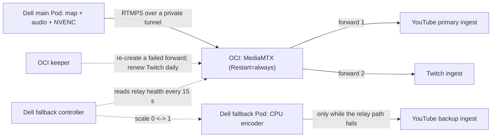

# Self-Healing OCI Fan-Out

## Current source and observed deployment

Since 2026-10-20 08:43 JST, the production media route uploads one feed from the
Dell encoder host to the OCI relay. The relay forwards that feed to YouTube and
Twitch. A second upload exists only while the relay path is failing: the Dell
host then starts a fallback sender that publishes directly to the YouTube backup
ingest, and it stops that sender after the relay path has been healthy for five
minutes.

The home uplink is the constraint that shapes this design. Sending YouTube and
Twitch separately from home would double the upload, so the relay does the
fan-out. Two uploads are allowed only during a fallback window, not as a
permanent configuration.

This route replaces the signed-lease relay described in
[OCI relay and Twitch](oci-relay-and-twitch.md). Why the earlier design was
retired is recorded in
[Retiring the signed-lease OCI route](oci-route-simplification-decision.md).

## Components and how each one recovers

| Component | Where it runs | Recovery behavior |
| --- | --- | --- |
| Main sender | Dell k3s Deployment `stream-v3-runtime` | The engine reconnects five seconds after a dropped connection; Kubernetes restarts a failed Pod. |
| Relay | OCI systemd `stream-v3-oci-mediamtx` | `Restart=always` with a three-second delay. RTMP, RTMPS, and the API are admitted only from the encoder over the tunnel. |
| Keeper | OCI systemd `stream-v3-oci-keeper` | Re-creates one forward that has not been forwarding, or has reported an error, for 30 seconds (at most once per minute per destination). Renews Twitch at 00:00 JST or after 46 hours. |
| Fallback controller | Dell systemd `stream-v3-fallback-controller` | Starts the fallback after 30 seconds of relay failure and stops it after 300 seconds of continuous relay health. |
| Fallback sender | Dell k3s Deployment `stream-v3-youtube-backup` | Normally zero replicas. While running, it reconnects on its own. |

Relay health means three things at once: the input path is ready, its received
byte counter advances, and the YouTube forward is `forwarding` without an error
while its outbound counter advances. An unreachable API or a missing sample
counts as unhealthy. The controller only stops the fallback after continuous
health; it never stops it because an observation is missing.

The monitoring host is not in this control loop. If monitoring is down, the
relay, keeper, and fallback controller still act on their own observations.

## Daily Twitch renewal

Twitch limits a session to 48 hours. The keeper removes only the Twitch
forward, waits for the Helix API to report OFFLINE for at least 120 seconds,
and restores the forward. If OFFLINE is never observed, it restores Twitch
after 600 seconds instead of leaving it down. The YouTube forward is never
modified. The JST date of the last renewal is persisted so a restart does not
renew twice on the same day.

The relay observer reports the renewal's scheduled time as today's 00:00 JST
while a renewal is in progress, and as the next 00:00 JST otherwise. The
monitoring host treats a Twitch OFFLINE as planned only within 360 seconds of
that time and only while a renewal is in progress, so the reported time must
not move to the next day mid-renewal.

As of this record, the first keeper-driven renewal (2026-10-21 00:00 JST) has
not yet been observed.

## Drill: stopping the relay (2026-10-20 08:55 to 09:03 JST)

The relay service was stopped by hand and started again two minutes later.

| Elapsed from stop | Observation |
| --- | --- |
| 0 s | The relay stops; YouTube primary and Twitch forwarding stop. |
| 14 s | The fallback controller sees the relay path as unhealthy. |
| 52 s | The controller starts the fallback Pod. |
| 62 s onward | The fallback sends to the YouTube backup ingest. The YouTube API reported the broadcast live, active, and good 40 seconds later. |
| 118 s | The relay is started again. |
| 125 s | The main Pod reconnects to the relay on its own; both forwards resume. |
| 129 s | Twitch reports a new session as LIVE. |
| 456 s | After 300 seconds of continuous relay health, the controller stops the fallback. |

The YouTube broadcast did not end. The gap in data reaching YouTube was about
65 seconds. Starting and stopping the fallback, reconnecting the main sender,
and resuming both forwards happened without an operator.

The drill also exposed a monitoring gap. The YouTube watchdog on the monitoring
host counts only the main Pod's connection as local delivery. During the drill
it confirmed an incident even though the fallback was sending. Because that
watchdog was allowed to create a replacement broadcast, a longer relay outage
could have replaced the live broadcast. Replacement broadcast creation has been
disabled; if a broadcast really ends, it is recreated by hand. Counting the
fallback connection as local delivery remains open.

## Upload measurement after the route change

After the route change, the public upload bitrate stayed at its last value
while the relay measured about 3.6 Mbps of input. The host-side process
observer accepts only an `rtmps://` FFmpeg as the delivery process, so the new
plain-RTMP sender was not recognized and no TCP send samples were produced.
Two port lists also omitted the new relay port.

The relay now also accepts RTMPS on a separate port with a self-signed
certificate bound to its tunnel address, and the main sender uses RTMPS. The
port lists for readiness and TCP sampling include the new port. Fresh samples
of 3.57 and 3.63 Mbps returned. Applying the change restarted the main Pod
three times, with gaps of about 38, 35, and 17 seconds; each recovered before
the fallback threshold.

Through the relay, the measured send rate is about 3.6 Mbps, compared with a
median of 4.88 Mbps on the earlier route, with unchanged encoder settings
(3400k video and 192k audio). The cause has not been identified.

While the fallback runs, the controller samples the fallback FFmpeg's
acknowledged bytes every 15 seconds and writes the rate to a Deployment
annotation. The public projection reads it and the status page shows both
uploads and their total. This path has unit tests but has not yet been
observed during a real fallback.

## Evidence boundaries

| Observation | Supported conclusion | Remaining uncertainty |
| --- | --- | --- |
| Relay input bytes advance | The relay receives the main sender's feed. | Provider reception is separate. |
| A forward is `forwarding` and its bytes advance | The relay is sending to that provider. | It does not show that the provider accepted decodable media. |
| YouTube API live / active / good | The provider reports a healthy broadcast. | Frame-level continuity for viewers is not measured. |
| Twitch Helix LIVE with a new session ID | A new Twitch session exists after renewal. | It does not show delivered audio or video. |
| One drill on 2026-10-20 | Automatic fallback and return work for a stopped relay service. | Tunnel loss, a relay host outage, and a provider-side failure were not exercised. |

Not yet verified: whether MediaMTX reconnects a dropped forward by itself (the
keeper compensates), a keeper renewal at midnight, the fallback upload rate
during a real fallback, and long-term soak.

## Reviewable implementation

- [Keeper](../../ops/selfheal/forward_keeper.py) and
  [fallback controller](../../ops/selfheal/fallback_controller.py), with
  [tests](../../tests/test_selfheal.py).
- [Example units](../../ops/selfheal/systemd/) and the
  [fallback Deployment](../../deploy/k3s/youtube-backup/deployment.json).
- [Relay observer](../../monitoring-v4/src/stream_monitoring_v4/compatibility/relay_observe.py)
  and [public projection](../../monitoring-v4/src/stream_monitoring_v4/compatibility/relay_public.py).

The units contain placeholders for tunnel addresses and the Twitch account.
Host installers, tunnel configuration, certificates, provider destinations,
and credentials are not part of the public source.
