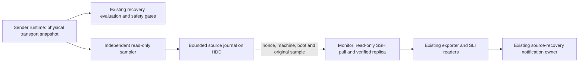

# Independent Upload Measurement

The upload measurement owner reads physical FFmpeg transport counters without
entering recovery evaluation. A safety rejection in recovery must not prevent
observing the sender. Current operated results are recorded in
[current status](../current-status.md); this page is the measurement contract.

## Why collection moved

The old collector emitted `tcp_send_sample` inside the recovery loop, after its
runtime-identity checks. A control observation with an unavailable protocol
identity caused a safe `NO_ACTION` return before sampling. The physical FFmpeg
process and its transport counters could still be present and advancing.
The resulting warning described a missing measurement source; it did not prove
that media delivery had stopped.

The correction preserves that recovery rejection. It gives a separate observer
permission to read only the physical telemetry already exported by the runtime.
It does not fill in the missing control identity or make a recovery action valid.

## Owners and data path

`stream_v3_upload_measurement.py sample` reads the fixed
`/run/stream-v3-control/runtime-observation.json`. It accepts a running physical
FFmpeg child with exactly one managed child, a positive local PID, producer
identity, sequence, generation, connection identity and finite transport counters.
It deliberately does not require `protocol_ffmpeg_pid`, `runtime_identity` or a
successful target snapshot. Those fields continue to govern their existing
control boundary.

The sampler has no network and cannot access the effect socket or recovery
database. It writes only its own directory. The puller uses the existing SSH
identity and a fixed, read-only `serve` command. Its write scope is the separate
`upload_measurement` directory. Neither service can restart, signal, scale or
switch media. The shipped systemd templates require explicit user, storage,
release and peer bindings; they are examples, not an automatic installer.

## Rate and freshness

The rate keeps the existing definition: `8 * delta(bytes_sent) / interval / 1e6`
in decimal Mbps, rounded to three decimal places. The interval belongs to the
original producer observations. Polling is every five seconds and an emitted
interval spans at least 60 and at most 180 seconds. A valid unchanged byte
counter can yield zero Mbps; a missing or invalid counter cannot.

A snapshot must be at most three seconds old on the source host. PID, producer,
FFmpeg generation, connection or boot changes and counter rollback discard the
rate baseline. A same-host UTC step over the existing 50 ms clock bound also
breaks the interval. A new interval is measured after the change; counters from
different generations are never subtracted.

The receiver checks the pinned machine, source host, source boot, fresh nonce
and bounded exchange before accepting a batch. Current age uses source
`CLOCK_BOOTTIME`, the whole exchange delay, elapsed receiver boottime and the
original counter age. Remote and local monotonic epochs are never subtracted.
The receiver keeps the source timestamp and a boot-bound receipt, and projects
a monitor-local UTC timestamp for historical joins. UTC steps on either host
cannot make a cached sample fresh. Receiver reboot invalidates prior receipts.

Every sample has an identity derived from its source, boot, producer, FFmpeg
generation, PID, connection and ending sequence. Repeated pulls do not append
another observation or renew the receipt. A fresh server status alone does not
prove that a fresh rate sample exists.

The current-source recovery rule is unchanged: raw and Prometheus evidence must
remain fresh for 900 seconds, within the existing 180-second source bound. The
Prometheus check requires the existing job and instance, `up == 1`, and every
point on its one-minute grid. The exporter's separate five-minute latest-value
display bound is retained. No historical Prometheus values are inserted.

## History, failure and rollback

An explicit `upload_measurement/source.json` selects the new owner and records
its cutover. Before that cutover, existing TCP history remains authoritative;
after it, the independent journal supplies measurements. Other recovery events
are unchanged. A selected but unavailable source produces UNKNOWN, without
falling back to a different fresh-looking log.

The source and replica use atomic state replacement, `fsync`, sample deduplication
and a bounded journal: 4 MiB plus one predecessor. Reads reject symlinks and
nonregular files. This is a size bound, not a promise of a week of raw retention.
The operated source journal is on HDD. Old logs, missing intervals, SLO targets,
formal coverage and historical rollups are retained rather than rewritten.
The SLI and health readers merge only measurement history; their recovery-event
inputs are not replaced.

Rollback restores the previous consumer release and exporter entry, disables
the selected source and stops only the added measurement services. The journals,
notification state, outbox and delivery audit remain intact. Consumers return
to the old source before the sampler is removed. A lost measurement after
rollback remains visible as missing evidence.

## Verification boundary

Isolated tests exercise the actual sampler, read-only serving command, receipt
validation, current-source reader, exporter hook and SLI integration. They cover
missing and ambiguous identity, UTC steps, source and receiver reboot, repeated
samples, counter rollback, rate continuity, forged or delayed batches, journal
rotation, and recovery without changing control decisions.

Production verification uses the real service users and mount restrictions,
unchanged metric labels and natural notifier cycles. It requires both a real
fifteen-minute raw/Prometheus window and closure of the existing source warning.
Provider acceptance of a recovery message is distinct from human visibility.
Transport counters establish measured upload, not uninterrupted public-player
video/audio or end-to-end delivery health.
