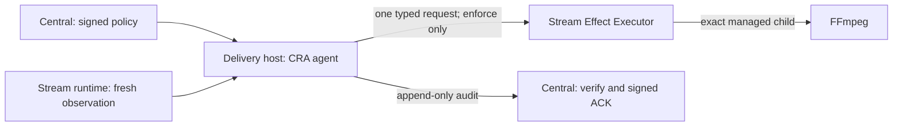

# CRA Architecture

The current CRA is the local reflex path. It has two services:

Central owns policy versions, thresholds, upper limits and the operating mode.
The agent evaluates the adopted policy, persists reservations and consumption,
and asks the Executor at most once for one FFmpeg generation. It uses the same
policy during a central-network outage and retains unacknowledged audit locally.
There is no second LAN-loss decider or authority handback state machine in CRA.

The Stream Executor owns physical effects, peer admission, exact target identity,
and a target-wide durable fence. Its implementation is in
[`../../src/runtime_boundary/`](../../src/runtime_boundary/); Stream's target
observer is in [`../../src/dell_recovery_agent/`](../../src/dell_recovery_agent/).
The agent uses the existing typed v2 request and read-only status queries.
Unresolved execution blocks another attempt; recovery observations never erase
an unknown result or refund consumed limits.

`dry_run` sends no restart request. A confirmed stall first waits for the engine's
own recovery (90 seconds by default), and a non-running lifecycle is not a reason
for CRA to interfere. FIFO output reconnection and FFmpeg lifecycle remain Stream
responsibilities. CRA never promotes a child restart to a container, Pod or host
restart.

Read the [current contract](local-reflex-authority.md),
[safety model](safety-model.md), [test boundaries](harness-trust.md), and
[operations](local-reflex-operations.md). The previous per-action central
approval design is preserved in [history](history.md), not installed here.
